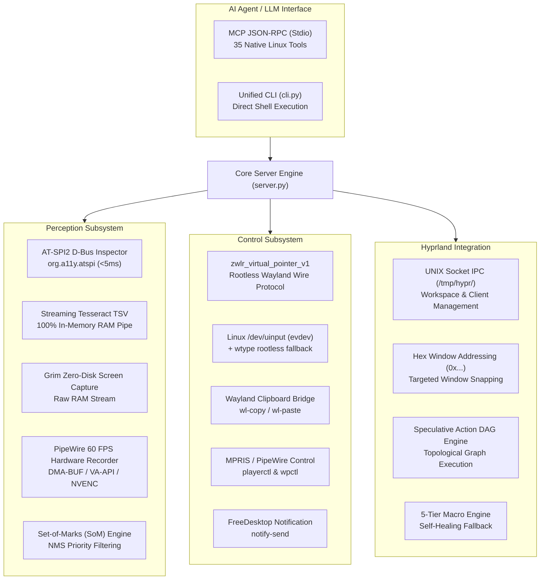

# Computer Control (AIM-VR 3.0 - Arch Linux Hyprland Edition)

[-blue.svg)](https://archlinux.org)
[](https://www.python.org/)
[](https://modelcontextprotocol.io/)
[](mcp_schemas/)
[-brightgreen.svg)](tests/)
[](LICENSE)

> [!NOTE]
> **Dedicated Linux Edition**: This repository branch (`feat/arch-hyprland`) is engineered 100% natively for **Arch Linux running Hyprland (Wayland)** with zero Windows dependencies.
> For the Windows 10 & 11 edition, see the [`main`](https://github.com/Arman4464/computer-control-aim-vr/tree/main) branch.

**Autonomous In-Memory Vision Runner (AIM-VR 3.0)** is an industrial-grade desktop automation, macro recording, and computer control engine engineered for LLMs and AI agents operating natively on **Arch Linux with Hyprland (Wayland)**.

Unlike standard vision-agent frameworks that suffer from sluggish multi-turn screenshot round-trips, coordinate misalignment, and desktop contention, AIM-VR 3.0 delivers **sub-30ms closed-loop execution**, **rootless unprivileged Wayland virtual pointer injection**, **zero-token AT-SPI2 semantic accessibility trees**, **zero-disk-write Grim screencopy and streaming OCR**, **a 5-tier self-healing Semantic Macro Engine**, and **speculative Action DAG orchestration**.

---

## Key Linux Subsystems

### 1. AT-SPI2 Semantic Accessibility Tree Inspector
Zero-token semantic accessibility tree extraction over the FreeDesktop D-Bus session bus (`org.a11y.atspi`). Traverses accessible objects, extracts live screen coordinate extents, filters Unicode Private Use Area (PUA) glyphs, and normalizes native roles (`push button` $\rightarrow$ `Button`, `entry` $\rightarrow$ `Edit`, `check box` $\rightarrow$ `CheckBox`, `list item` $\rightarrow$ `ListItem`) for GTK, Qt, Electron, and Firefox applications with zero vision token consumption.

### 2. Unprivileged Wayland Virtual Pointer Protocol Client
Direct binary wire protocol client connecting to the compositor socket at `$XDG_RUNTIME_DIR/$WAYLAND_DISPLAY` and binding `zwlr_virtual_pointer_manager_v1`. Provides 100% rootless, unprivileged mouse cursor positioning, clicking, dragging, and 24.8 fixed-point axis scrolling with dynamic desktop resolution scaling from `HyprlandWindowManager`. Includes fallback to `/dev/uinput` and `wtype`.

### 3. PipeWire 60 FPS Hardware Screen Recording Portal
GPU hardware-accelerated desktop and window recording utilizing `wl-screenrec` / `wf-recorder` via DMA-BUF (Intel/AMD VA-API and NVIDIA NVENC) for smooth 60–120 FPS recording with near-zero CPU overhead. Automatically transcodes to high-compression animated WebP or raw MP4 upon completion.

### 4. Zero-Disk-Write Streaming OCR Engine
In-memory Tesseract TSV OCR streamed through Linux pipes directly in RAM with zero disk writes. Rapidly extracts word bounding boxes, supports multi-word query localization, and handles sub-pixel text grounding.

### 5. 5-Tier Self-Healing Macro Engine
Captures repeatable UI workflows with Ramer-Douglas-Peucker (RDP) trajectory compression ($\epsilon = 2.5\text{ px}$) and 32x32 visual difference perceptual hashing (pHash). Replays with 5-tier fallback: `AT-SPI2 -> LinuxOCR -> pHash -> Relative -> Hyprland IPC Sync`.

---

## Linux System Architecture



---

## Cardinal Operating Invariants

Every agent or operator using AIM-VR 3.0 must adhere to seven non-negotiable rules:

1. **NEVER FALL INTO THE TURN-BY-TURN "SCREENSHOT & GUESS" ANTI-PATTERN**: Never take a screenshot after every single click. For 2+ actions, dispatch the sequence via `execute_autonomous_task`, `execute_action_dag`, or `macro_play` to execute locally in an in-memory closed loop in <2 seconds.
2. **THE TWO-PHASE MODAL PROTOCOL (NEVER CANCEL WITH "X")**: When dealing with dialogs, flairs, dropdowns, or modals: click the target option $\rightarrow$ locate and click the commit action button (`"Apply"`, `"Save"`, `"Done"`, `"Confirm"`). Never click `X` to exit a modal after selecting an option.
3. **THE CHROMIUM & WEB APP RULE (NO AT-SPI DOM TREES)**: Modern GPU web browsers (Google Chrome, Brave) do not expose DOM elements to Linux accessibility trees. Always use Layer 2 text grounding: `click(text="Label")` or companion `browser_dom_action`.
4. **NEVER SEND BLIND DESTRUCTIVE SHORTCUTS (Alt+F4 / Super+Q)**: Global shortcuts strike whatever window currently has focus. Always use targeted window closing: `close_window(target="...")` or `aimvr close "<Title>"`.
5. **PREFER NATIVE WAYLAND CLIPBOARD FOR ALL TEXT & CODE**: Always use `clipboard(action="paste", text="...")` or `paste_text` step. Keystroke-by-keystroke simulation is vulnerable to dropped keys; native `wl-clipboard` injection is instantaneous.
6. **VERIFY SCREEN STATE BEFORE ACTING ("Look Before You Touch")**: Call `get_screen_info` to inspect `visible_windows`, client addresses, and active workspace before initiating window transitions.
7. **RESTORE USER WORKSPACE STATE ("Leave No Trace")**: When finished, return to the user's active workspace and original focused window.

---

## 35 Native Linux MCP Tools

| Tool | Category | Behavior |
|---|---|---|
| `inspect_ui` | Perception | Traverses `org.a11y.atspi` D-Bus accessibility tree for GTK/Qt/Electron/Firefox. |
| `ocr_screen` | Perception | Zero-disk-write in-memory Tesseract TSV OCR scan. |
| `find_element` | Perception | Locates UI element bounding box `[x, y, w, h]` and center via AT-SPI2 or OCR. |
| `screenshot` | Perception | Fast pipe-streamed `grim` screencopy to RAM. |
| `take_som_screenshot` | Perception | Overlays OmniParser numbered marks for visual grounding. |
| `click_som_mark` | Perception | Clicks an indexed SoM badge by integer ID. |
| `move_cursor` | Control | Moves cursor via `zwlr_virtual_pointer_v1` or Hyprland IPC `movecursor`. |
| `mouse_down` | Control | Presses mouse button via unprivileged Wayland virtual pointer. |
| `mouse_up` | Control | Releases mouse button via unprivileged Wayland virtual pointer. |
| `click` | Control | Atomic click sequence by coordinate, AT-SPI query, or OCR text label. |
| `drag` | Control | Smooth interpolated mouse drag across display. |
| `scroll` | Control | Wayland 24.8 fixed-point axis wheel scroll (-down, +up). |
| `type_text` | Control | Character-by-character keyboard typing via virtual pointer/evdev. |
| `press_key` | Control | Individual key press/release event dispatch. |
| `hotkey` | Control | Multi-key combination dispatch (e.g. `["ctrl", "c"]`). |
| `clipboard` | Control | Native Wayland clipboard get/set/paste via `wl-copy` / `wl-paste`. |
| `focus_window` | Control | Switches workspace and focuses target window by title or client address. |
| `close_window` | Control | Targeted Hyprland `closewindow address:<hex>` dispatch. |
| `manage_window` | Control | Workspace movement, fullscreen, and floating state management. |
| `get_screen_info` | Control | Returns monitor geometries, active workspace, and all Hyprland clients. |
| `launch_app` | Control | Launches application via `dispatch exec` or `xdg-open`. |
| `control_media` | Control | MPRIS track and volume control via `playerctl` / PipeWire `wpctl`. |
| `notify` | Control | FreeDesktop desktop notification dispatch via `notify-send`. |
| `record_screen` | Control | Hardware-accelerated 60 FPS PipeWire DMA-BUF portal recording (`wl-screenrec`). |
| `wait_for` | Control | In-engine condition polling loop eliminating LLM turn-by-turn latency. |
| `configure_safety` | Control | Adjusts speed profiles and user mouse contention governor. |
| `execute_autonomous_task`| Execution | Closed-loop local multi-step workflow runner in <2 seconds. |
| `execute_action_dag` | Execution | High-performance DAG pipeline with topological sorting and variable interpolation. |
| `macro_record` | Execution | Captures repeatable user/agent workflows with RDP trajectory compression. |
| `macro_play` | Execution | Replays macro with 5-tier self-healing fallback. |
| `macro_manage` | Execution | Manages stored macro files (list, get, delete). |
| `browser_bridge_status` | Extension | Checks connection to companion Chrome/Brave extension. |
| `browser_dom_action` | Extension | Direct DOM click/fill dispatch via companion extension. |
| `com_browser_cdp` | Extension | Direct WebSocket Chrome DevTools Protocol tab navigation. |

---

## Unified Command-Line Interface (`cli.py`)

Run actions, inspect UI, execute macros, or run full DAG pipelines directly from the terminal without writing scripts:

```bash
# 1. Inspect screen, monitors, active workspace, and Hyprland clients
python cli.py info

# 2. Hybrid Semantic Macro Engine
python cli.py macro record start --name daily_workflow
python cli.py macro record stop
python cli.py macro play daily_workflow --speed 1.5
python cli.py macro list

# 3. Direct AT-SPI2 / OCR semantic click
python cli.py click --query "Submit"
python cli.py click --x 500 --y 300 --double

# 4. Window snapping and workspace movement
python cli.py window "Firefox" --workspace 2
python cli.py window "Alacritty" --state floating
python cli.py close "Calculator"

# 5. Native Wayland clipboard text paste
python cli.py paste "Instant multiline code or text insertion"

# 6. Streaming in-memory OCR text recognition
python cli.py ocr --query "Terminal"

# 7. Hardware multimedia & notification control
python cli.py media volume_up --steps 2
python cli.py media play_pause
python cli.py notify --title "Build Complete" --message "100% tests passing"

# 8. Hardware-accelerated 60 FPS PipeWire screen recording
python cli.py record start --fps 60 --cursor
python cli.py record stop --output demo.webp

# 9. Execute Speculative Action DAG
python cli.py dag '[{"id": "open", "action": "launch_app", "name": "firefox"}, {"id": "wait", "action": "wait", "duration": 1.0, "depends_on": ["open"]}]'
```

---

## Installation & Setup on Arch Linux

### Method 1: Arch Linux Pacman Package (`PKGBUILD`)
The cleanest installation method for Arch Linux users builds with full system integration:

```bash
git clone -b feat/arch-hyprland https://github.com/Arman4464/computer-control-aim-vr.git
cd computer-control-aim-vr
makepkg -si
```

This installs:
- The `computer-control` package into system Python.
- `/usr/lib/udev/rules.d/99-aimvr-uinput.rules` for non-root `/dev/uinput` input simulation.
- `/usr/lib/modules-load.d/aimvr-uinput.conf` to automatically load the `uinput` kernel module on boot.
- MIT License to `/usr/share/licenses/computer-control-aim-vr/LICENSE`.

### Method 2: Python Virtual Environment
For development or sandboxed usage:

```bash
# 1. Install system dependencies via pacman
sudo pacman -S grim wl-clipboard libnotify tesseract tesseract-data-eng wl-screenrec wf-recorder playerctl pipewire wireplumber

# 2. Clone and set up virtual environment
git clone -b feat/arch-hyprland https://github.com/Arman4464/computer-control-aim-vr.git
cd computer-control-aim-vr
python -m venv .venv
source .venv/bin/activate
pip install -e .
```

---

## MCP Server Configuration

To connect AIM-VR 3.0 to Antigravity, Claude Desktop, Cursor, or any MCP-compatible agent host:

Add to your MCP configuration file (`mcpSettings.json` or `claude_desktop_config.json`):

```json
{
  "mcpServers": {
    "computer-control": {
      "command": "python",
      "args": ["-m", "server"],
      "cwd": "/path/to/computer-control-aim-vr"
    }
  }
}
```

---

## Testing & Quality Assurance

AIM-VR 3.0 includes an exhaustive automated test suite validating all Wayland wire protocols, D-Bus interfaces, and input fallback chains:

```bash
# Run headless test suite
python -m unittest tests/test_linux_sota.py tests/test_platform.py -v
```

### Covered Test Matrix:
- **AT-SPI2 FreeDesktop D-Bus**: Accessibility tree extraction, coordinate resolution, and Unicode Private Use Area (PUA) glyph filtering.
- **Wayland Virtual Pointer Protocol**: Binary wire protocol framing (`zwlr_virtual_pointer_v1`), 24.8 fixed-point coordinate mapping, relative motion opcode 0, and clean opcode 8 teardown.
- **Dynamic Desktop Bounds**: Scaling across 1080p, 1440p, 4K, and non-negative clamping preventing `struct.pack` crashes.
- **Rootless Input Fallback**: Fallback from `/dev/uinput` to `wtype` and Hyprland IPC `sendshortcut`.
- **Hardware-Accelerated PipeWire Recording**: `wl-screenrec` and `wf-recorder` argument formatting across 30, 60, and 120 FPS with VA-API / NVENC pipelines.
- **5-Tier Self-Healing Macro Engine**: AT-SPI2 semantic anchor recording, hex window address parsing (`"0x..."`), and Tier 5 IPC synchronization barrier.
- **Speculative Action DAG**: In-memory `LinuxOCR` condition evaluation, variable interpolation, and application launch readiness polling.
- **Wayland Clipboard Bridge**: 15-retry exponential backoff and format readiness verification.

---

## License

This project is licensed under the [MIT License](LICENSE) — see the LICENSE file for details.
