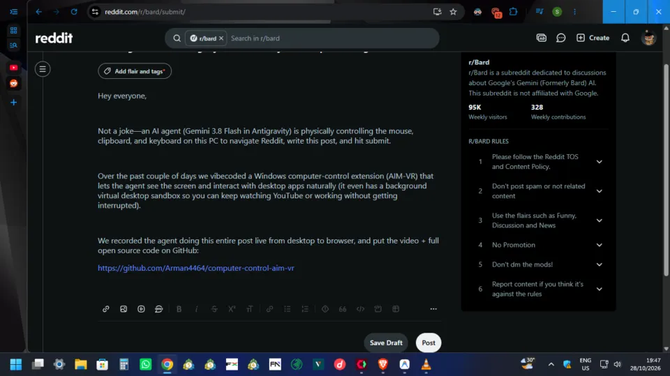
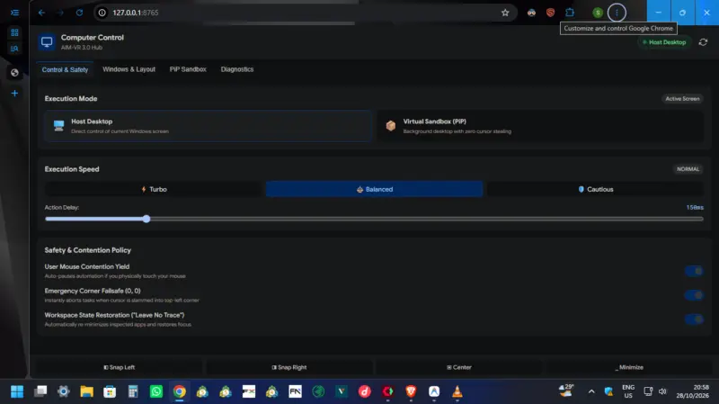

# Computer Control (AIM-VR 3.0)

[](https://archlinux.org)
[](https://www.python.org/)
[](https://modelcontextprotocol.io/)
[](mcp_schemas/)
[-brightgreen.svg)](tests/)
[](LICENSE)

**Autonomous In-Memory Vision Runner (AIM-VR 3.0)** is an industrial-grade desktop automation, macro recording, and computer control engine engineered for LLMs and AI agents operating natively on **Windows 10/11** and **Arch Linux with Hyprland (Wayland)**.

Unlike standard vision-agent frameworks that suffer from sluggish multi-turn screenshot round-trips, coordinate misalignment, and desktop contention, AIM-VR 3.0 delivers **sub-30ms closed-loop execution**, **hardware-level kernel `/dev/uinput` and Win32 input injection**, **sub-15ms local native OCR**, **zero-disk-write Grim and GDI screencopy pipelines**, **a 5-tier self-healing Semantic Macro Engine**, and **speculative Action DAG orchestration**.

---

## Supported Operating Systems & Compositors

| Feature | Windows 10 & 11 | Arch Linux (Hyprland / Wayland) |
| :--- | :--- | :--- |
| **Input Engine** | Win32 `SendInput` (hardware scan-codes & unicode) | Linux `/dev/uinput` kernel virtual device, `wtype`, `ydotool` |
| **Compositor / Window IPC** | Win32 User32 / DWM / VirtualDesktop COM | Direct Hyprland UNIX domain socket (`.socket.sock` & `.socket2.sock`) |
| **Screen Capture** | Win32 GDI `BitBlt` / `PrintWindow` | Pipe-streamed `grim` (`wlr-screencopy-unstable-v1`) direct to RAM |
| **Workspaces / Desktops** | Windows COM `IVirtualDesktopManager` | Hyprland dynamic workspaces (`dispatch workspace / movetoworkspace`) |
| **Clipboard** | Win32 `OpenClipboard` / `CF_UNICODETEXT` | Native `wl-clipboard` (`wl-copy` / `wl-paste` text & PNG) |
| **Notifications** | WinRT Action Center Toast XML | FreeDesktop D-Bus / `notify-send` |
| **App Execution** | Win32 `ShellExecuteExW` & App Paths Registry | Hyprland session `dispatch exec` & `xdg-open` |
| **Audio & Media** | Win32 multimedia virtual key dispatch | PipeWire `wpctl`, PulseAudio `pactl`, multimedia keys |

---

## Live Demonstrations

### 1. Autonomous Live Reddit Submission
Continuous 15 FPS hardware cursor screen recording showing the AI agent autonomously navigating Google Chrome, applying flairs with the Two-Phase Modal Protocol, and submitting the post in ~3.2 seconds without turn-by-turn screenshot micromanagement:



### 2. Sidecar Hub & Desktop Virtualization Tour
Tour of the Web-based Sidecar Control Hub (`http://localhost:8765`), showing real-time system diagnostics, layout snapping, and Picture-in-Picture sandbox virtualization:



---

## Key Capabilities

- **Zero-Token High-Speed COM Connectors (Tier 0)**: Direct object-model automation for File Explorer (`Shell.Application`), Microsoft Excel (`Excel.Application`), and Chromium browsers (`Chrome/Edge CDP`) without taking screenshots or consuming LLM vision tokens.
- **Hybrid Semantic Macro Engine**: Record human or agent interactions with Ramer-Douglas-Peucker (RDP) trajectory compression ($\epsilon = 2.5\text{ px}$), visual perceptual hashing (32x32 pHash), and replay with 5-tier self-healing fallback (`UIA -> OCR -> pHash -> Relative -> Sync`).
- **Speculative Action DAG Engine**: Declare non-linear execution graphs with topological sorting, variable interpolation (`{{steps.id.result}}`), and closed-loop micro-servoing verification.
- **Isolated Virtual Desktop Sandboxing**: Spawn background tasks on dedicated Win32 desktops (`AIMVR_Sandbox`) with real-time Picture-in-Picture (PiP) preview. Zero mouse/keyboard cursor hijacking.
- **Sub-15ms Local Native WinRT OCR**: Persistent background PowerShell daemon tapping hardware-accelerated Windows Runtime OCR with zero API latency and zero cloud costs.
- **OmniParser V2 Set-of-Marks (SOM)**: Hierarchical element detection with Non-Maximum Suppression (NMS) and numbered badge overlays for deterministic visual grounding.
- **Per-Monitor DPI Aware V2**: Exact physical-to-virtual coordinate transformations handling mixed-DPI setups and negative coordinate multi-monitor arrays.
- **Native Win32 Clipboard Bridge**: Atomic text injection via global Win32 memory allocations and simulated `Ctrl+V` for instantaneous multi-line code and text insertion.
- **Window State & Lifecycle Hardening**: Targeted `WM_CLOSE` / `SC_CLOSE` message dispatch, window snapping (grid, quadrants, monitor work area), and elevated process awareness.
- **Desktop Contention Governor**: Real-time user physical mouse contention detection and configurable corner failsafe (`(0,0)` abort).

---

## System Architecture

```
                                      +-----------------------+
                                      |    AI Agent / LLM     |
                                      +-----------------------+
                                                  |
                            +---------------------+---------------------+
                            |                                           |
                   MCP JSON-RPC (Stdio)                                CLI
                   (41 Standard Tools)                                  |
                            |                                           |
                            +---------------------+---------------------+
                                                  v
                                      +-----------------------+
                                      |   server.py / cli.py  |
                                      +-----------------------+
                                                  |
            +-------------------------------------+-------------------------------------+
            |                                     |                                     |
            v                                     v                                     v
+-------------------------------+ +-------------------------------+ +-------------------------------+
|     Perception Subsystem      | |      Control Subsystem        | |     Isolation & Connectors    |
|-------------------------------| |-------------------------------| |-------------------------------|
| * WinRT OCR Daemon (<15ms)    | | * Per-Monitor DPI V2 Engine   | | * Shell.Application COM       |
| * UI Automation (UIA) Tree    | | * Hardware ScanCode Hotkeys   | | * Excel.Application COM       |
| * GDI / PrintWindow Capture   | | * Win32 Clipboard Injection   | | * Chrome / Edge CDP           |
| * Differential Dirty-Rects    | | * Window Layout / Snapping    | | * Zero-Flag DOM Companion     |
| * OmniParser V2 SOM Badging   | | * Visual Servoing (<30ms)     | | * Win32 Virtual Desktop       |
| * Multi-Monitor Geometries    | | * Safety Contention Governor  | | * PiP Sandbox Compositor      |
| * 32x32 Perceptual Hash       | | * Macro Engine (RDP + 5-Tier) | | * Speculative DAG Engine      |
+-------------------------------+ +-------------------------------+ +-------------------------------+
```

---

## Cardinal Operating Invariants

Every agent or operator using AIM-VR 3.0 must adhere to seven non-negotiable rules:

1. **NEVER FALL INTO THE TURN-BY-TURN "SCREENSHOT & GUESS" ANTI-PATTERN**: Never take a screenshot after every single click. For 2+ actions, dispatch the sequence via `execute_autonomous_task`, `execute_action_dag`, or `macro_play` to execute locally in an in-memory closed loop in <2 seconds.
2. **THE TWO-PHASE MODAL & DIALOG PROTOCOL**: Click target option $\rightarrow$ click commit button (`"Apply"`, `"Save"`, `"Done"`, `"Confirm"`). Never click `X` to exit a modal after making a selection.
3. **THE CHROMIUM & WEB APP RULE**: Chromium apps do not expose DOM trees to Windows UIA. Use Layer 2 sub-15ms WinRT OCR text grounding or Tier 0 `browser_dom_action`.
4. **NEVER SEND BLIND DESTRUCTIVE SHORTCUTS (`Alt+F4` / `Ctrl+W`)**: Global shortcuts strike whichever window happens to have foreground focus. Always use targeted `close_window(target="...")` which delivers Win32 `WM_CLOSE` messages directly to the target HWND without disturbing other apps.
5. **PREFER NATIVE CLIPBOARD FOR LONG TEXT / CODE**: For code, URLs, or paragraphs, always use `clipboard(action="paste", text="...")` or the `paste_text` step. Keystroke simulation (`type_text`) is slower and prone to dropped characters under load.
6. **VERIFY SCREEN STATE BEFORE ACTING ("Look Before You Touch")**: Inspect open windows and foreground focus using `get_screen_info` before triggering state changes.
7. **WORKSPACE & WINDOW STATE RESTORATION ("Leave No Trace")**:
   - If an application was unminimized to read data, **minimize it back** once done (`manage_window(target="...", action="state", state="minimize")`).
   - If a helper app was opened solely to perform a task, **close it cleanly** (`close_window(target="...")`).
   - Always **restore foreground focus** to the user's primary application when complete.

---

## Model Context Protocol (MCP) Tools Reference (41 Tools)

AIM-VR 3.0 exposes 41 specialized MCP tools adhering to protocol version `2024-11-05`:

### 1. High-Speed Programmatic & Browser Connectors (Tier 0)
| Tool | Arguments | Purpose |
|---|---|---|
| `com_explorer` | `action` (`list`/`open`/`get_selected`), `path` | Zero-token direct Shell.Application navigation, folder listing, and selected items. |
| `com_excel` | `action` (`status`/`read_cell`/`write_cell`/`read_range`), `cell`, `value`, `sheet`, `rows`, `cols` | Direct Excel COM worksheet read/write; zero screenshot latency. |
| `com_browser_cdp` | `action` (`list_tabs`/`navigate`/`evaluate_script`), `port`, `target_id`, `url`, `expression` | Chrome/Edge Chrome DevTools Protocol tab management and script evaluation. |
| `browser_dom_action` | `action` (`click`/`fill`/`get_text`/`get_dom`/`query`), `selector`, `text`, `value`, `timeout` | Sub-5ms DOM queries, clicks, form filling, and DOM inspection via zero-flag companion extension. |

### 2. Browser Companion Status & Diagnostics
| Tool | Arguments | Purpose |
|---|---|---|
| `browser_bridge_status` | None | Checks the health of the companion browser extension loopback bridge and active tab info. |

### 3. Autonomous Execution & Orchestration
| Tool | Arguments | Purpose |
|---|---|---|
| `execute_action_dag` | `steps` (list), `stop_on_error` (bool), `auto_verify` (bool) | Non-linear Action DAG execution with dependency resolution, variable interpolation, and sub-30ms servoing. |
| `execute_autonomous_task` | `steps` (list), `verify` (bool) | In-memory closed-loop runner with sub-30ms pixel-diff verification. |

### 4. Hybrid Semantic Macro Engine
| Tool | Arguments | Purpose |
|---|---|---|
| `macro_record` | `action` (`start`/`stop`/`cancel`), `name` | Records mouse and keyboard interactions with 5-tier semantic anchors and RDP polyline compression. |
| `macro_play` | `name`, `speed_multiplier`, `self_heal`, `dry_run` | Replays recorded macros with 5-tier self-healing fallback (`UIA -> OCR -> pHash -> Relative -> Sync`). |
| `macro_manage` | `action` (`list`/`get`/`delete`/`export`/`import`), `name`, `macro_data` | Lists saved macros, retrieves full macro definitions, or deletes recorded macros. |

### 5. Virtual Desktop & PiP Sandboxing
| Tool | Arguments | Purpose |
|---|---|---|
| `sandbox_launch` | `command` (string), `desktop_name` (string) | Spawns applications on an isolated background Win32 desktop (`AIMVR_Sandbox`). |
| `sandbox_manage` | `action` (`status`/`close_window`/`destroy`), `target` | Inspects, closes, or terminates sandboxed desktop environments. |
| `sandbox_capture` | `desktop_name` (string) | Generates a Picture-in-Picture composite preview of background desktop windows. |

### 6. Visual Perception & Grounding
| Tool | Arguments | Purpose |
|---|---|---|
| `get_screen_info` | None | Returns screen bounds, monitors, DPI scaling, foreground window, and visible windows list. |
| `ocr_screen` | `target` (string), `query` (string) | Sub-15ms local WinRT OCR spotting and bounding box extraction. |
| `screenshot` | `target` (string), `mode` (`full`/`delta`/`pip`), `som` (bool) | Screen capture with optional differential cropping or OmniParser Set-of-Marks badges. |
| `inspect_ui` | `target` (string), `max_depth` (int), `max_elements` (int) | Low-token hierarchical text dump of the Windows UI Automation (UIA) tree. |
| `find_element` | `query`, `target`, `role`, `scope`, `region` | Unified hybrid locator across UIA (Layer 1) and WinRT OCR (Layer 2) with modal dialog scoping. |
| `record_screen` | `action` (`start`/`stop`/`status`), `output_path`, `fps`, `max_dim`, `format` | Continuous high-speed screen recorder compiling 24-bit animated WebP/GIF with hardware cursor stamping. |

### 7. OmniParser Set-of-Marks (SOM)
| Tool | Arguments | Purpose |
|---|---|---|
| `take_som_screenshot` | `target`, `client_only`, `max_elements` | Captures window/screen, extracts elements via UIA + WinRT OCR + contours, and renders numbered badges (`[1]`, `[2]`, `[3]`). |
| `click_som_mark` | `mark_id`, `button`, `clicks` | Clicks an indexed SoM element mark directly by ID with zero coordinate guessing. |

### 8. Granular Input Control
| Tool | Arguments | Purpose |
|---|---|---|
| `click` | `query`, `target`, `mark_id`, `x`, `y`, `clicks`, `button` | Multi-tier click resolution: UIA -> OCR -> SOM -> coordinates. |
| `hover` | `query`, `target`, `x`, `y`, `duration` | Moves cursor and hovers to trigger tooltips or flyout menus. |
| `move_cursor` | `x`, `y`, `coords_mode` | Per-Monitor DPI aware cursor positioning. |
| `mouse_down` | `button` (`left`/`right`/`middle`), `x`, `y` | Atomic mouse button press. |
| `mouse_up` | `button` (`left`/`right`/`middle`), `x`, `y` | Atomic mouse button release. |
| `drag` | `start_x`, `start_y`, `end_x`, `end_y`, `duration` | Smooth bezier/interpolated mouse drag with synchronized cursor updates. |
| `scroll` | `clicks` (int), `x` (float), `y` (float), `delta_x`, `delta_y` | Hardware mouse wheel vertical and horizontal scrolling. |
| `type_text` | `text` (string), `interval` (float) | Direct Unicode key event injection (`KEYEVENTF_UNICODE`). |
| `hotkey` | `keys` (list) | Hardware scan-code combinations (`ctrl`, `alt`, `win`, `shift`, etc.). |
| `press_key` | `key` (string), `down` (bool), `up` (bool) | Granular hardware key down/up event control. |

### 9. Window Lifecycle & Clipboard Management
| Tool | Arguments | Purpose |
|---|---|---|
| `clipboard` | `action` (`get`/`set`/`paste`), `text`, `restore` | Win32 native clipboard manager with instant paste simulation. |
| `manage_window` | `target`, `action` (`snap`/`state`/`move_resize`), `position`, `state`, `bounds` | Snaps window to monitor work area regions or toggles minimize/maximize/restore. |
| `focus_window` | `target` (string) | Bypasses `LockSetForegroundWindow` to bring window to verified foreground. |
| `close_window` | `target` (string), `force` (bool) | Targeted non-destructive `WM_CLOSE` window closure. |

### 10. System Utilities & Execution Lifecycle
| Tool | Arguments | Purpose |
|---|---|---|
| `launch_app` | `name` (string), `args` (string) | Intelligent application resolution via App Paths, PATH, and ShellExecute. |
| `control_media` | `action` (`volume_up`/`volume_down`/`toggle_mute`/`play_pause`/etc.), `steps` | Non-invasive hardware multimedia control. |
| `configure_safety` | `speed`, `failsafe`, `contention`, `desktop_mode` | Adjusts execution delay, corner abort, and desktop mode. |
| `notify` | `title`, `message`, `app_id`, `sound` | Sends native Windows Action Center toast notifications with optional sound. |
| `registry` | `mode`, `path`, `name`, `value`, `val_type`, `view64` | High-speed native Windows Registry manager (`get`, `set`, `delete_value`, `delete_key`, `list`). |
| `wait_for` | `condition`, `target`, `query`, `timeout`, `interval` | In-engine polling for UI conditions (`text_exists`, `window_exists`, `window_active`, `element_exists`) to eliminate LLM polling loops. |

---

## Unified Command-Line Interface (`cli.py`)

Run actions, inspect UI, execute macros, or run full DAG pipelines directly from the terminal:

```powershell
# 1. Inspect screen, monitors, foreground, and all open windows
python cli.py info

# 2. Hybrid Semantic Macro Engine
python cli.py macro record start --name report_generation
python cli.py macro record stop
python cli.py macro play report_generation --speed 1.5
python cli.py macro list

# 3. Direct File Explorer COM navigation
python cli.py explorer --list
python cli.py explorer --open "shell:Downloads"
python cli.py explorer --selected

# 4. Direct Excel COM read / write
python cli.py excel --status
python cli.py excel --write A1 "Automated"
python cli.py excel --read A1

# 5. Window snapping and management
python cli.py window "Notepad" --snap left
python cli.py window "Chrome" --state minimize
python cli.py close "Notepad"

# 6. Native Win32 instant clipboard paste
python cli.py clipboard --paste "Instant multiline code insertion"

# 7. Local WinRT OCR text recognition
python cli.py ocr --query "Downloads"

# 8. Hardware multimedia control
python cli.py media volume_up --steps 2
python cli.py media play_pause

# 9. PiP Sandbox desktop management
python cli.py sandbox --launch "notepad.exe"
python cli.py sandbox --status
python cli.py sandbox --capture
python cli.py sandbox --destroy

# 10. Execute Speculative Action DAG
python cli.py dag '[{"id": "open", "action": "launch_app", "name": "notepad"}, {"id": "snap", "action": "manage_window", "target": "Notepad", "sub_action": "snap", "position": "left", "depends_on": ["open"]}]'
```

---

## Installation & Setup

### Arch Linux (Hyprland / Wayland)

1. **Install system dependencies via `pacman`**:
   ```bash
   sudo pacman -S --needed hyprland grim slurp wl-clipboard libinput tesseract python-pillow
   ```

2. **Configure `/dev/uinput` permissions (for hardware-level mouse/keyboard)**:
   ```bash
   sudo cp assets/99-aimvr-uinput.rules /etc/udev/rules.d/
   sudo udevadm control --reload-rules && sudo udevadm trigger
   sudo usermod -aG input $USER
   ```
   *(Note: `ydotool` and `wtype` are automatically detected and used as zero-setup fallbacks).*

3. **Install the package using `PKGBUILD`**:
   ```bash
   makepkg -si
   ```
   Or install via pip in editable mode:
   ```bash
   pip install -e .
   ```

---

### Windows 10 & 11

1. **Clone the repository**:
   ```powershell
   git clone https://github.com/Arman4464/computer-control-aim-vr.git
   cd computer-control-aim-vr
   ```

2. **Install dependencies**:
   ```powershell
   pip install -r requirements.txt
   ```

3. **Run the automated test suite**:
   ```powershell
   python -m unittest discover -s tests -v
   ```

---

## MCP Server Configuration

To attach AIM-VR 3.0 to Antigravity, Claude Desktop, Cursor, or any MCP-compatible agent host:

Add to your `mcpSettings.json` or `claude_desktop_config.json`:

```json
{
  "mcpServers": {
    "computer-control": {
      "command": "python",
      "args": [
        "C:\\path\\to\\computer-control-aim-vr\\server.py"
      ]
    }
  }
}
```

---

## Testing & Quality Assurance

The codebase includes an exhaustive test suite verifying every component against live Win32 APIs:

```powershell
# Run the complete test suite
python -m unittest discover -s tests -v
```

### Covered Test Matrix:
- Multi-monitor negative-offset coordinate transformations & Per-Monitor DPI V2 scaling.
- Scan-code translation with OEM symbol protection (semicolons, quotes, slashes).
- Win32 clipboard global memory allocation round-trips.
- Monitor work-area window snapping and aspect ratios.
- Safety governor speed profiles, corner failsafe, and user contention detection.
- WinRT OCR daemon integration and bounding box accuracy.
- OmniParser V2 Set-of-Marks, Intersection-over-Union (IoU), and Non-Maximum Suppression (NMS).
- Speculative Action DAG execution, cycle detection, and template variable substitution.
- Virtual Desktop creation, struct alignment, and PiP compositing.
- Stdio JSON-RPC pipeline compatibility (`Content-Type` / `Content-Length` headers).
- Macro Engine Ramer-Douglas-Peucker (RDP) polyline trajectory compression.
- Macro Engine 32x32 visual difference perceptual hashing (pHash) and Hamming distance.
- Macro Engine 5-tier self-healing fallback resolution (`UIA -> OCR -> pHash -> Relative -> Sync`).

---

## License

This project is licensed under the [MIT License](LICENSE) — see the LICENSE file for details.
