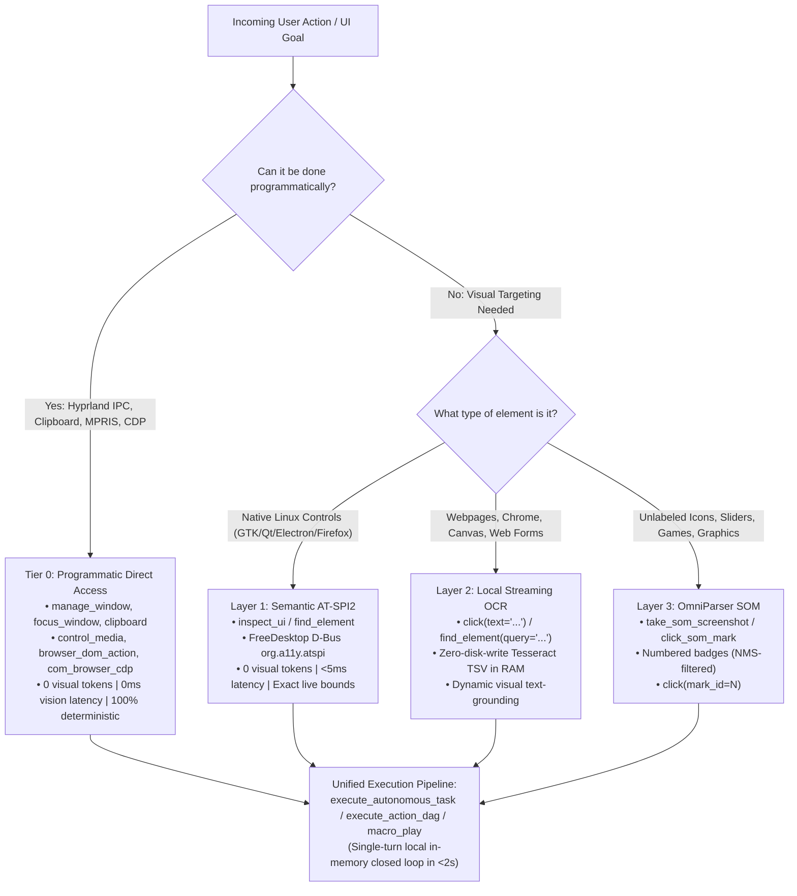

# Computer Control & Interaction Engine (AIM-VR 3.0 - Arch Linux Hyprland Edition)

Industrial-grade, multi-tier desktop automation and perception subsystem engineered specifically for **Arch Linux running Hyprland (Wayland)**. Designed for AI agents to achieve **sub-30ms execution, zero hallucination, and massive token savings** over traditional screenshot-and-think computer-use loops.

---

## 1. The Multi-Tier Targeting Hierarchy & Vision Engine

Before capturing pixels or invoking vision pipelines, determine if the goal can be executed directly via **Tier 0 Programmatic Access**. If visual perception is required, traverse the 3-Layer visual hierarchy in descending order of determinism.



### Tier 0: Programmatic Direct Access (Zero Visual Overhead)
- **Best for**: Window management (`manage_window`), focus switching (`focus_window`), clipboard text injection (`clipboard`), audio/media playback (`control_media`), desktop notifications (`notify`), and browser DOM manipulation (`browser_dom_action`, `com_browser_cdp`).
- **Behavior**: Direct Hyprland UNIX domain socket IPC (`hyprctl dispatch`), `wl-clipboard`, `playerctl` MPRIS, and WebSocket CDP. Bypasses the graphics pipeline entirely.
- **Latency & Tokens**: **0 ms visual latency, 0 visual tokens burned**, 100% immune to window occlusion or resolution shifts.

### Layer 1: Semantic AT-SPI2 Accessibility Inspection
- **Best for**: Native Linux desktop applications (GTK4, Qt6, Electron, Firefox, LibreOffice, system dialogs).
- **Behavior**: Reads the FreeDesktop AT-SPI2 accessibility tree over D-Bus (`org.a11y.atspi`). Returns zero-token, exact bounding boxes and semantic control roles (`Button`, `Edit`, `CheckBox`, `ListItem`, `Window`) in <5ms.
- **Tools**: `inspect_ui`, `find_element(role="Button")`, `click(query="...")`.

### Layer 2: High-Speed Local Streaming OCR (Text Grounding)
- **Best for**: Web browsers (Chrome, Brave, Firefox), Electron applications (VS Code, Slack, Discord), web forms, tables, modals.
- **Behavior**: Executes in-memory Tesseract TSV parsing streamed directly through zero-disk-write RAM pipes. Resolves text labels (`"Title"`, `"Post"`, `"Discussion"`, `"Apply"`, `"Save"`) to live physical screen coordinates.
- **Tools**: `click(text="Submit")`, `find_element(query="Apply")`, `ocr_screen(query="Export")`.

### Layer 3: OmniParser Set-of-Marks (SOM)
- **Best for**: Unlabeled graphical icons, video players, canvas sliders, games, and pure graphic controls where no text or AT-SPI metadata exists.
- **Behavior**: Overlays high-contrast, NMS-filtered numbered badges (Yellow=AT-SPI, Green=OCR, Cyan=Icons) for integer clicking (`click_som_mark(mark_id=5)`).
- **Rule**: **STRICTLY a fallback**. Never invoke Layer 3 when Layer 1 or Layer 2 text is present.

---

## 2. Cardinal Operating Invariants (7 Non-Negotiable Rules)

> [!CAUTION]
> ### 1. THE TURN-BY-TURN "SCREENSHOT & GUESS" ANTI-PATTERN (STRICTLY FORBIDDEN)
> **Never fall into the slow, token-burning loop of taking a full screenshot after every single micro-action.**
> - *The Anti-Pattern*: `screenshot -> inspect -> click(x, y) -> screenshot -> click(x, y)`. This burns 25,000+ tokens, introduces 10-second chat latency per step, and frequently misses when dynamic layouts reflow.
> - *The Mandatory Rule*: For any multi-step workflow (2+ actions), **ALWAYS dispatch the sequence in a single turn** via `execute_autonomous_task`, `execute_action_dag`, or `macro_play`. The host engine executes the entire sequence locally at native speed with closed-loop visual servoing in <2 seconds.

> [!IMPORTANT]
> ### 2. THE TWO-PHASE MODAL & DIALOG PROTOCOL (NEVER CANCEL WITH "X")
> When interacting with modals, popups, or dialogs (e.g. flair pickers, "Save As", cookie banners, dropdowns):
> 1. **Phase 1: Selection Phase**: Click the target option, radio button, or tag (e.g. `click(text="Discussion")`).
> 2. **Phase 2: Commit Phase**: You **MUST** locate and click the dialog's commit action button (`"Apply"`, `"Save"`, `"Add"`, `"Done"`, `"Confirm"`, `"OK"`, `"Submit"`).
> - **Strict Prohibition**: **NEVER click `X` (close) after making a selection**. Clicking `X` discards your selection and cancels the dialog!
> - **The Scroll Rule**: If the commit button is below the visible dialog fold, scroll down inside the dialog (`scroll(clicks=-3)`) before trying to close or give up.

> [!IMPORTANT]
> ### 3. THE CHROMIUM & WEB APP RULE (NO AT-SPI DOM TREES)
> Modern GPU/browser applications (Google Chrome, Brave, Chromium) do **NOT** expose their web DOM elements to Linux accessibility trees by default.
> - **Never** expect `inspect_ui` to find internal webpage buttons.
> - **Always** use Layer 2 text grounding: `click(text="Button Label")`, `find_element(query="Search")`, or companion `browser_dom_action(action="click", selector="...")`. This triggers local in-memory OCR or instant DOM dispatch directly.

> [!CAUTION]
> ### 4. NEVER SEND BLIND DESTRUCTIVE SHORTCUTS (Alt+F4 / Ctrl+W / Super+Q)
> **Never** execute blind `hotkey(["alt", "f4"])` or `hotkey(["super", "q"])` to close an application. Global shortcuts strike whatever window happens to have foreground focus—potentially terminating the user's active editor, music stream, or terminal.
> - **Mandatory Rule**: ALWAYS use `close_window(target="...")` or CLI `aimvr close "<Title>"`. This sends targeted `closewindow address:<hex>` IPC requests directly to the target window via Hyprland socket without touching active applications.

> [!IMPORTANT]
> ### 5. PREFER NATIVE WAYLAND CLIPBOARD FOR ALL TEXT & CODE (`clipboard` or `paste_text`)
> For typing code, paragraphs, URLs, or multiline text, **ALWAYS** use `clipboard(action="paste", text="...")` or `paste_text` step. Keystroke-by-keystroke simulation (`type_text`) is slow and vulnerable to layout shifts or dropped keys under system load. Native `wl-clipboard` injection (`wl-copy` / `wl-paste`) is instantaneous and 100% accurate.

> [!IMPORTANT]
> ### 6. VERIFY SCREEN STATE BEFORE ACTING ("Look Before You Touch")
> Call `get_screen_info` to inspect `visible_windows` (all open windows, titles, client addresses, workspace IDs, monitor geometry) and `foreground_window` before initiating window transitions. Never assume an app is focused or running.

> [!IMPORTANT]
> ### 7. WORKSPACE & WINDOW STATE RESTORATION ("Leave No Trace")
> **Always restore the user's workspace to its exact prior state once a task completes:**
> - **Workspaces**: If you switched to an alternate workspace to perform an action, return to the user's active workspace: `manage_window(action="workspace", workspace="1")`.
> - **Spawned Apps**: If you opened an application solely to accomplish a task (e.g. text editor, calculator), **close it cleanly** when finished: `close_window(target="...")`.
> - **Focus Restoration**: Always return active focus to the user's original working window (e.g., Antigravity IDE / terminal) so their typing workflow is completely undisturbed.

---

## 3. Tool Selection Matrix (35 Native Linux Tools)

| User Intent / Scenario | Recommended Tool | Interface & Behavior |
|---|---|---|
| **Multi-step workflow (2+ actions)** | `execute_autonomous_task(steps=[...])` | Autonomous In-Memory Runner. Executes entire sequence locally with closed-loop verification in <2s. |
| **Complex DAG with dependencies** | `execute_action_dag(steps=[...])` | High-performance DAG pipeline with topological sorting, variable interpolation (`{{steps.id.result}}`), and sub-30ms servoing. |
| **Record repeatable GUI macro** | `macro_record(action="start"|"stop"|"cancel")` | High-precision event capture with Ramer-Douglas-Peucker trajectory compression and 5-tier semantic anchors. |
| **Replay macro with self-healing** | `macro_play(macro_name="...", speed=1.0)` | Replays macro with 5-tier fallback (`AT-SPI -> OCR -> pHash -> Relative -> Sync`). |
| **List or manage macros** | `macro_manage(action="list"|"get"|"delete")` | Inspects, exports, or deletes recorded macro definitions from local storage. |
| **Direct Browser DOM (Tier 0)** | `browser_dom_action(action="click"|"fill")` | Zero-flag Companion Chrome Extension bridge; instant DOM execution. |
| **Direct Chrome CDP (Tier 0)** | `com_browser_cdp(action="list_tabs"|"navigate")` | Direct WebSocket Chrome DevTools Protocol interface. |
| **Click button / link / form by label** | `click(text="Submit", target="Chrome")` | Resolves live physical center via AT-SPI2 or streaming OCR. Auto-focuses window before clicking. |
| **Locate element / inspect coordinates** | `find_element(query="Apply", scope="window")` | Finds exact physical screen bounding box `[x, y, w, h]` and center `(cx, cy)` without taking a full screenshot. |
| **Inspect UI accessibility tree** | `inspect_ui(target="Firefox")` | Queries D-Bus `org.a11y.atspi` and returns complete semantic control hierarchy with zero vision tokens. |
| **Continuous Screen Recording** | `record_screen(action="start"|"stop"|"status")` | Hardware-accelerated 60 FPS PipeWire DMA-BUF portal recording (`wl-screenrec` / `wf-recorder`) with animated WebP/MP4 export. |
| **Instant paste long text or code** | `clipboard(action="paste", text="...")` | Instant Wayland clipboard text injection via `wl-copy` followed by simulated atomic `Ctrl+V`. |
| **Snap / arrange / workspace window** | `manage_window(target="...", action="workspace", workspace="2")` | Moves windows across dynamic workspaces or toggles fullscreen/floating via Hyprland IPC. |
| **Safely close an app/window** | `close_window(target="Window Title")` | Sends Hyprland IPC `closewindow address:<hex>` directly to target window. 100% immune to closing foreground music/browser. |
| **Focus window by title or address** | `focus_window(target="Terminal")` | Switches to window's workspace and focuses it instantly via Hyprland socket. |
| **Launch an app or URL** | `launch_app(name="firefox")` | Executes via Hyprland `dispatch exec` or `xdg-open`; waits for window to appear. |
| **Scroll window or element** | `scroll(clicks=-3, x=500, y=400)` | Scrolls mouse wheel (-down, +up) at specified coordinates via unprivileged Wayland virtual pointer. |
| **Control media playback** | `control_media(action="volume_up"|"play_pause")` | Adjusts volume or controls MPRIS tracks via `playerctl` or PipeWire `wpctl`. |
| **Send desktop notification** | `notify(title="Build Done", message="All tests passed")` | Dispatches native FreeDesktop notification via `notify-send`. |
| **Inspect screen, monitors & windows** | `get_screen_info()` | Queries Hyprland IPC for active workspace, monitor geometries, foreground window, and full `visible_windows` list. |
| **OmniParser Set-of-Marks Badging** | `take_som_screenshot(target="...")` | Renders indexed marks `[1]`, `[2]`, `[3]` over visual elements for zero-guesswork clicking. |
| **Click indexed SoM mark** | `click_som_mark(mark_id=5)` | Clicks an indexed SoM element mark directly by ID. |
| **Local condition wait** | `wait_for(condition="text_exists", query="Ready")` | Local polling loop inside the engine eliminating LLM turn-by-turn wait round-trips. |

---

## 4. Practical Automation Recipes (Native Linux Wayland)

### Recipe A: Autonomous Web Navigation & Multi-Step Form Submission
Execute a multi-step sequence inside Google Chrome in a single turn without taking intermediate screenshots:

```json
{"name": "execute_autonomous_task", "arguments": {
  "task_description": "Submit issue on GitHub",
  "steps": [
    {"action": "focus", "target": "GitHub"},
    {"action": "click", "text": "New issue"},
    {"action": "wait", "duration": 0.5},
    {"action": "click", "text": "Get started"},
    {"action": "wait", "duration": 0.5},
    {"action": "click", "text": "Title"},
    {"action": "paste_text", "text": "feat(linux): implement AT-SPI2 accessibility tree inspector"},
    {"action": "click", "text": "Write"},
    {"action": "paste_text", "text": "Implements zero-token D-Bus accessibility tree parsing over org.a11y.atspi."},
    {"action": "click", "text": "Submit new issue"}
  ]
}}
```

---

### Recipe B: Window Management & Workspace Organization
Move applications cleanly across Hyprland dynamic workspaces:

```json
// 1. Move target window to workspace 2:
{"name": "manage_window", "arguments": {"target": "Discord", "action": "workspace", "workspace": "2"}}

// 2. Focus window by title or client address:
{"name": "focus_window", "arguments": {"target": "Firefox"}}

// 3. Toggle window floating state:
{"name": "manage_window", "arguments": {"target": "Calculator", "action": "state", "state": "floating"}}
```

---

### Recipe C: High-Speed Screen Recording (60 FPS PipeWire DMA-BUF)
Capture smooth video walkthroughs with hardware acceleration:

```json
// 1. Start 60 FPS recording with cursor:
{"name": "record_screen", "arguments": {"action": "start", "fps": 60, "include_cursor": true}}

// ... (agent or user performs operations) ...

// 2. Stop and save as animated WebP or MP4:
{"name": "record_screen", "arguments": {"action": "stop", "output_path": "/tmp/demo.webp", "format": "webp"}}
```

---

### Recipe D: In-Engine Condition Waiting (`wait_for`)
Eliminate LLM polling turns and token burn by letting the local engine poll for UI state readiness:

```json
// Wait up to 5.0 seconds for 'Build succeeded' text to appear on screen:
{"name": "wait_for", "arguments": {
  "condition": "text_exists",
  "query": "Build succeeded",
  "timeout": 5.0,
  "interval": 0.25
}}

// Wait for a modal or app window to open:
{"name": "wait_for", "arguments": {
  "condition": "window_exists",
  "target": "Confirm Save",
  "timeout": 3.0
}}
```

---

### Recipe E: Desktop Notifications & Workspace State Cleanup
Alert the user with native FreeDesktop notifications and cleanly restore active workspace:

```json
// 1. Send desktop notification via notify-send:
{"name": "notify", "arguments": {
  "title": "AIM-VR Automated Task",
  "message": "Deployment completed successfully. All services active.",
  "app_id": "aim-vr"
}}

// 2. Return user to workspace 1 ('Leave No Trace'):
{"name": "manage_window", "arguments": {
  "action": "workspace",
  "workspace": "1"
}}
```

---

### Recipe F: Programmatic Tier 0 Direct Operations (IPC, MPRIS, Clipboard)
Bypass the visual pipeline completely with zero visual tokens and zero vision latency:

```json
// 1. Instant Wayland clipboard injection (wl-copy + atomic paste):
{"name": "clipboard", "arguments": {
  "action": "paste",
  "text": "export HYPRLAND_INSTANCE_SIGNATURE=$(ls -t $XDG_RUNTIME_DIR/hypr | head -n 1)"
}}

// 2. Control background media playback via playerctl / MPRIS:
{"name": "control_media", "arguments": {
  "action": "play_pause"
}}

// 3. Safe targeted window termination (immune to killing active focus):
{"name": "close_window", "arguments": {
  "target": "Calculator"
}}
```

---

### Recipe G: 5-Tier Self-Healing Macro Engine Workflows (`macro_record`, `macro_play`)
Record repetitive UI workflows with 5-tier semantic anchors:

```json
// 1. Start recording macro:
{"name": "macro_record", "arguments": {"action": "start", "name": "daily_deploy"}}

// ... (user or agent executes steps across applications) ...

// 2. Stop recording:
{"name": "macro_record", "arguments": {"action": "stop"}}

// 3. Replay macro at 1.5x speed with 5-tier self-healing fallback:
{"name": "macro_play", "arguments": {"name": "daily_deploy", "speed_multiplier": 1.5, "self_heal": true}}
```

CLI Equivalent:
```bash
aimvr macro record start --name daily_deploy
aimvr macro record stop
aimvr macro play daily_deploy --speed 1.5
aimvr macro list
```

---

## 5. Deterministic Troubleshooting & Recovery Matrix

| Symptom / Error | Root Cause | Deterministic Fix |
|---|---|---|
| Wayland virtual pointer permission denied | Running on non-Wayland display or compositor without `zwlr_virtual_pointer_v1`. | Engine automatically checks `$WAYLAND_DISPLAY` and binds `zwlr_virtual_pointer_manager_v1` directly. Ensure Hyprland or wlroots compositor is running. |
| First click swallowed / button doesn't fire | Window was inactive or on different workspace. | `focus_window` automatically switches workspaces via Hyprland socket and activates client address before click dispatch. |
| Empty AT-SPI2 tree on Chrome / web browser | Chromium apps do not expose DOM nodes to Linux accessibility tree by default. | **Follow Invariant #3**: Use Layer 2 streaming Tesseract OCR text grounding (`click(text="...")`) or companion `browser_dom_action`. |
| Coordinate drift after typing / scrolling | Hardcoding coordinates from stale OCR dumps. | **Use `click(text="Button Label")`**. It runs high-speed in-memory OCR and resolves live physical pixel centers on the current visual frame. |
| Modal closes without applying changes | Agent clicked `X` (close) instead of commit button. | **Follow Invariant #2**: Click selection $\rightarrow$ Click `"Apply"` / `"Save"` / `"Add"`. Never click `X` to exit a modal after selecting an option. |
| Dropped keys or slow text insertion | Simulating keystrokes for large text. | **Use `clipboard(action="paste", text="...")`** or `paste_text` step for instant `wl-clipboard` injection. |
| Screen recording high CPU load | Falling back to software capture polling. | Install `wl-screenrec` or `wf-recorder` (`pacman -S wl-screenrec`). The engine automatically uses GPU DMA-BUF hardware encoding at 60 FPS. |
| Missing window in window list | Target window is on inactive workspace. | `get_screen_info()` queries all active and inactive Hyprland clients from socket IPC (`clients` json), ensuring hidden workspaces are fully enumerated. |
