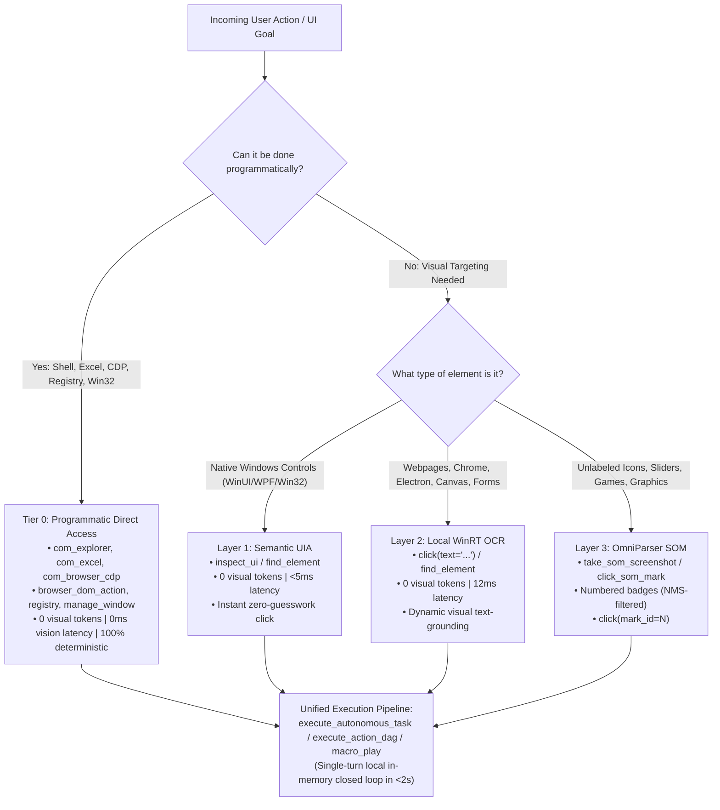

# Computer Control & Interaction Engine (AIM-VR 3.0)

Industrial-grade, multi-tier desktop automation and perception subsystem for Windows and Arch Linux (Hyprland / Wayland). Designed specifically for AI agents to achieve **sub-30ms execution, zero hallucination, and massive token savings** over traditional screenshot-and-think computer-use loops.

---

## 1. The Multi-Tier Targeting Hierarchy & Vision Engine

Before capturing pixels or invoking vision pipelines, determine if the goal can be executed directly via **Tier 0 Programmatic Access**. If visual perception is required, traverse the 3-Layer visual hierarchy in descending order of determinism.



### Tier 0: Programmatic Direct Access (Zero Visual Overhead)
- **Best for**: File Explorer (`com_explorer`), Excel spreadsheets (`com_excel`), Chrome/Edge DOM manipulation (`com_browser_cdp`, `browser_dom_action`), System Registry (`registry`), and targeted window management (`manage_window`, `close_window`).
- **Behavior**: Direct COM, WebSocket CDP, or Win32 API calls. Bypasses the graphics pipeline entirely.
- **Latency & Tokens**: **0 ms visual latency, 0 visual tokens burned**, 100% immune to window occlusion or resolution shifts.

### Layer 1: Semantic UI Automation (UIA)
- **Best for**: Native Windows desktop applications (Notepad, File Explorer, Calculator, Windows Settings, WinUI dialogs, MMC consoles).
- **Behavior**: Reads the Windows UI Automation accessibility tree directly. Returns zero-token, exact bounding boxes in <5ms.
- **Tools**: `inspect_ui`, `find_element(role="Button")`, `click(query="...")`.

### Layer 2: High-Speed Local WinRT OCR (Text Grounding)
- **Best for**: Web browsers (Chrome, Edge, Brave), Electron applications (VS Code, Slack, Discord), web forms, tables, modals.
- **Behavior**: Executes 100% locally via Windows.Media.Ocr. Automatically resolves text labels (`"Title"`, `"Post"`, `"Discussion"`, `"Apply"`, `"Save"`) to live physical screen coordinates in **12 milliseconds**.
- **Tools**: `click(text="Submit")`, `find_element(query="Apply")`, `ocr_screen(query="Export")`.

### Layer 3: OmniParser Set-of-Marks (SOM)
- **Best for**: Unlabeled graphical icons, video players, canvas sliders, games, and pure graphic controls where no text or UIA metadata exists.
- **Behavior**: Overlays high-contrast, NMS-filtered numbered badges (Yellow=UIA, Green=OCR, Cyan=Icons) for integer clicking (`click_som_mark(mark_id=5)`).
- **Rule**: **STRICTLY a fallback**. Never invoke Layer 3 when Layer 1 or Layer 2 text is present.

---

## 2. Cardinal Operating Invariants (7 Non-Negotiable Rules)

> [!CAUTION]
> ### 1. THE TURN-BY-TURN "SCREENSHOT & GUESS" ANTI-PATTERN (STRICTLY FORBIDDEN)
> **Never fall into the slow, token-burning loop of taking a full screenshot after every single micro-action.**
> - *The Anti-Pattern*: `take_screenshot -> inspect -> click(x, y) -> take_screenshot -> click(x, y)`. This burns 25,000+ tokens, introduces 10-second chat latency per step, and frequently misses when dynamic layouts reflow.
> - *The Mandatory Rule*: For any multi-step workflow (2+ actions), **ALWAYS dispatch the sequence in a single turn** via `execute_autonomous_task`, `execute_action_dag`, or `macro_play`. The host engine executes the entire sequence locally at native speed with closed-loop visual servoing in <2 seconds.

> [!IMPORTANT]
> ### 2. THE TWO-PHASE MODAL & DIALOG PROTOCOL (NEVER CANCEL WITH "X")
> When interacting with modals, popups, or dialogs (e.g. flair pickers, "Save As", cookie banners, dropdowns):
> 1. **Phase 1: Selection Phase**: Click the target option, radio button, or tag (e.g. `click(text="Discussion")`).
> 2. **Phase 2: Commit Phase**: You **MUST** locate and click the dialog's commit action button (`"Apply"`, `"Save"`, `"Add"`, `"Done"`, `"Confirm"`, `"OK"`, `"Submit"`).
> - **Strict Prohibition**: **NEVER click `X` (close) after making a selection**. Clicking `X` discards your selection and cancels the dialog!
> - **The Scroll Rule**: If the commit button is below the visible dialog fold, scroll down inside the dialog (`scroll(clicks=-3)`) before trying to close or give up.

> [!IMPORTANT]
> ### 3. THE CHROMIUM & WEB APP RULE (NO UIA DOM TREES)
> Modern GPU/browser applications (Google Chrome, Brave, Edge, Electron apps) do **NOT** expose their web DOM elements to Windows UI Automation by default.
> - **Never** expect `inspect_ui` to find internal webpage buttons.
> - **Always** use Layer 2 text grounding: `click(text="Button Label")`, `find_element(query="Search")`, or companion `browser_dom_action(action="click", selector="...")`. This triggers local 12ms WinRT OCR or instant DOM dispatch directly.

> [!CAUTION]
> ### 4. NEVER SEND BLIND DESTRUCTIVE SHORTCUTS (Alt+F4 / Ctrl+W)
> **Never** execute blind `hotkey(["alt", "f4"])` or `hotkey(["ctrl", "w"])` to close an application. Global shortcuts strike whatever window happens to have foreground focus—potentially terminating the user's active browser, music stream (e.g. YouTube / Spotify), or unsaved editor.
> - **Mandatory Rule**: ALWAYS use `close_window(target="...")` or CLI `python cli.py close "<Title>"`. This sends targeted Win32 `WM_CLOSE` messages directly to the target window's HWND without touching active foreground applications.

> [!IMPORTANT]
> ### 5. PREFER NATIVE CLIPBOARD FOR ALL TEXT & CODE (`clipboard` or `paste_text`)
> For typing code, paragraphs, URLs, or multiline text, **ALWAYS** use `clipboard(action="paste", text="...")` or `paste_text` step. Keystroke-by-keystroke simulation (`type_text`) is slow and vulnerable to layout shifts or dropped keys under system load. Native Win32 clipboard injection is instantaneous and 100% accurate.

> [!IMPORTANT]
> ### 6. VERIFY SCREEN STATE BEFORE ACTING ("Look Before You Touch")
> Call `get_screen_info` to inspect `visible_windows` (all open windows, titles, PIDs, bounds, monitor geometry) and `foreground_window` before initiating window transitions. Never assume an app is focused or running.

> [!IMPORTANT]
> ### 7. WORKSPACE & WINDOW STATE RESTORATION ("Leave No Trace")
> **Always restore the user's desktop to its exact prior state once a task completes:**
> - **Minimized Apps**: If an application was minimized and you restored it to perform an action, **minimize it back** immediately when finished: `manage_window(target="...", action="state", state="minimize")`.
> - **Spawned Apps**: If you opened an application solely to accomplish a task (e.g. Notepad, File Explorer), **close it cleanly** when finished: `close_window(target="...")`.
> - **Focus Restoration**: Always return active foreground focus to the user's original working window (e.g., Antigravity IDE / terminal) so their typing workflow is completely undisturbed.

---

## 3. Tool Selection Matrix

| User Intent / Scenario | Recommended Tool | Interface & Behavior |
|---|---|---|
| **Multi-step workflow (2+ actions)** | `execute_autonomous_task(steps=[...])` | Autonomous In-Memory Runner. Executes entire sequence locally with closed-loop verification in <2s. |
| **Complex DAG with dependencies** | `execute_action_dag(steps=[...])` | High-performance DAG pipeline with topological sorting, variable interpolation (`{{steps.id.result}}`), and sub-30ms servoing. |
| **Record repeatable GUI macro** | `macro_record(action="start"|"stop"|"cancel")` | High-precision event capture with Ramer-Douglas-Peucker trajectory compression and 5-tier semantic anchors. |
| **Replay macro with self-healing** | `macro_play(macro_name="...", speed=1.0)` | Replays macro with 5-tier fallback (`UIA -> OCR -> pHash -> Relative -> Sync`). |
| **List or manage macros** | `macro_manage(action="list"|"get"|"delete")` | Inspects, exports, or deletes recorded macro definitions from local storage. |
| **Direct Explorer navigation (Tier 0)** | `com_explorer(action="list"|"open"|"get_selected")` | Direct Shell.Application COM interface; instant zero-token navigation. |
| **Direct Excel read/write (Tier 0)** | `com_excel(action="read_cell"|"write_cell")` | Direct Excel.Application COM interface; zero-pixel cell manipulation. |
| **Direct Browser DOM (Tier 0)** | `browser_dom_action(action="click"|"fill")` | Zero-flag Companion Chrome Extension bridge; instant DOM execution. |
| **Click button / link / form by label** | `click(text="Submit", target="Chrome")` | Resolves live physical center via local WinRT OCR or UIA in 12ms. Auto-activates window before clicking. |
| **Locate element / inspect coordinates** | `find_element(query="Apply", scope="modal")` | Finds exact physical screen bounding box `[x, y, w, h]` and center `(cx, cy)` without taking a full screenshot. |
| **Continuous Screen Recording** | `record_screen(action="start"|"stop"|"status")` | High-speed, continuous 15-30 FPS recording with physical cursor stamping and high-compression 24-bit WebP/GIF export. |
| **Instant paste long text or code** | `clipboard(action="paste", text="...")` | Instant Win32 clipboard text injection followed by atomic `Ctrl+V`. Immune to layout corruption. |
| **Snap / arrange / resize window** | `manage_window(target="...", action="snap", position="left")` | Snaps window to monitor work area (left, right, top, bottom, quadrants, center) or sets exact pixel bounds. |
| **Safely close an app/window** | `close_window(target="Window Title")` | Sends Win32 `WM_CLOSE` directly to target HWND. 100% immune to closing foreground music/browser. |
| **Launch an app or URL** | `launch_app(name="chrome")` | Resolves standard paths, App Paths registry, or system PATH; waits for window to appear. |
| **Non-disruptive background sandbox** | `sandbox_launch(command="notepad.exe")` | Spawns application on isolated sandbox desktop (`AIMVR_Sandbox`). Zero cursor hijacking. |
| **Capture PiP sandbox preview** | `sandbox_capture()` or `screenshot(mode="pip")` | Renders Picture-in-Picture composite preview of all windows open in background sandbox. |
| **Scroll window or element** | `scroll(clicks=-3, x=500, y=400)` | Scrolls mouse wheel (-down, +up) at specified coordinates. |
| **Control media playback** | `control_media(action="volume_up"|"play_pause")` | Adjusts volume or controls media tracks without switching active windows. |
| **Inspect screen, monitors & windows** | `get_screen_info()` | Returns virtual screen bounds, monitor work areas, foreground window, and full `visible_windows` list. |
| **OmniParser Set-of-Marks Badging** | `take_som_screenshot(target="...")` | Renders indexed marks `[1]`, `[2]`, `[3]` over visual elements for zero-guesswork clicking. |
| **Click indexed SoM mark** | `click_som_mark(mark_id=5)` | Clicks an indexed SoM element mark directly by ID. |

---

## 4. High-Yield Execution Recipes

### Recipe A: Multi-Step Autonomous Web Task (Form + Modal + Submit in 1 Turn)
Use `execute_autonomous_task` to complete an entire multi-step form workflow in **one single tool call** locally:

```json
{
  "name": "execute_autonomous_task",
  "arguments": {
    "steps": [
      {"action": "focus_window", "target": "Chrome"},
      {"action": "click", "text": "Title"},
      {"action": "paste_text", "text": "Announcing AIM-VR 3.0 Computer Control"},
      {"action": "click", "text": "Add flair and tags"},
      {"action": "click", "text": "Discussion"},
      {"action": "click", "text": "Add"},
      {"action": "click", "text": "Body text"},
      {"action": "paste_text", "text": "Here is the full demonstration of autonomous computer control..."},
      {"action": "scroll", "clicks": -3},
      {"action": "click", "text": "Post"}
    ],
    "verify": true
  }
}
```

---

### Recipe B: Continuous Screen Recording for Live Demos (`record_screen`)
Capture fluid demonstration videos with hardware mouse cursor overlay:

```json
// 1. Start continuous 15 FPS recording:
{
  "name": "record_screen",
  "arguments": {
    "action": "start",
    "fps": 15,
    "include_cursor": true,
    "max_dim": 960,
    "quality": 80
  }
}

// 2. Perform actions... (via execute_autonomous_task or MCP tools)

// 3. Stop recording and compile animated WebP / GIF:
{
  "name": "record_screen",
  "arguments": {
    "action": "stop",
    "output_path": "assets/demo_recording.webp",
    "format": "webp"
  }
}
```

---

### Recipe C: Window Management & Layout Snapping (`manage_window`)
Organize windows cleanly on any monitor without triggering Windows Snap popup grids:

```json
// Snap Notepad to left half of screen:
{"name": "manage_window", "arguments": {"target": "Notepad", "action": "snap", "position": "left"}}

// Maximize Chrome:
{"name": "manage_window", "arguments": {"target": "Chrome", "action": "state", "state": "maximize"}}
```

---

### Recipe D: In-Engine Condition Waiting (`wait_for`)
Wait locally for an app to launch, a window to become active, or text to appear without slow LLM polling:

```json
// Wait up to 10s for Chrome to launch and open:
{"name": "wait_for", "arguments": {"condition": "window_exists", "target": "Chrome", "timeout": 10.0}}

// Wait for a submit button to become visible on page:
{"name": "wait_for", "arguments": {"condition": "text_exists", "query": "Submit", "timeout": 5.0}}
```

---

### Recipe E: Native Toast Notifications & System Registry (`notify`, `registry`)
Notify the user when a long task completes, or read/write system configurations directly:

```json
// Send native Windows Action Center toast:
{"name": "notify", "arguments": {"title": "Task Finished", "message": "All items compiled successfully!"}}

// Read a Windows Registry setting:
{"name": "registry", "arguments": {"mode": "get", "path": "HKCU\\Software\\MyApp", "name": "Version"}}
```

---

### Recipe F: Programmatic Direct Tier 0 Operations (`com_explorer`, `com_excel`, `browser_dom_action`)
Bypass vision entirely for direct object-model manipulation:

```json
// List files in Downloads via COM:
{"name": "com_explorer", "arguments": {"action": "list", "path": "shell:Downloads"}}

// Write data to Excel cell B2:
{"name": "com_excel", "arguments": {"action": "write_cell", "cell": "B2", "value": "Revenue 2026"}}

// Click a web button by CSS selector via companion extension:
{"name": "browser_dom_action", "arguments": {"action": "click", "selector": "#submit-btn"}}
```

---

### Recipe G: Hybrid Semantic Macro Engine Workflows (`macro_record`, `macro_play`, `macro_manage`)
Record human or agent interactions with 5-tier semantic anchors, compress trajectories via RDP, and replay with self-healing fallback:

```json
// 1. Start recording a macro:
{"name": "macro_record", "arguments": {"action": "start", "name": "daily_report_prep"}}

// ... (user or agent executes steps across applications) ...

// 2. Stop recording and save semantic anchors:
{"name": "macro_record", "arguments": {"action": "stop"}}

// 3. Replay macro at 1.5x speed with 5-tier self-healing fallback:
{"name": "macro_play", "arguments": {"name": "daily_report_prep", "speed_multiplier": 1.5, "self_heal": true}}

// 4. List saved macros:
{"name": "macro_manage", "arguments": {"action": "list"}}
```

CLI Equivalent:
```powershell
python cli.py macro record start --name daily_report_prep
python cli.py macro record stop
python cli.py macro play daily_report_prep --speed 1.5
python cli.py macro list
```

---

## 5. Deterministic Troubleshooting & Recovery Matrix

| Symptom / Error | Root Cause | Deterministic Fix |
|---|---|---|
| First click swallowed / button doesn't fire | Window was inactive (`WM_MOUSEACTIVATE` consumed click). | Target windows are automatically activated with a 20ms message tick prior to click dispatch. |
| Coordinate drift after typing / scrolling | Hardcoding coordinates from stale OCR dumps. | **Use `click(text="Button Label")`**. It executes a 12ms WinRT OCR scan and resolves live physical pixel centers on the current visual frame. |
| Modal closes without applying changes | Agent clicked `X` (close) instead of commit button. | **Follow Invariant #2**: Click selection $\rightarrow$ Click `"Apply"` / `"Save"` / `"Add"`. Never click `X` to exit a modal after selecting an option. |
| Empty UIA tree on Chrome / web browser | Chromium apps do not expose DOM nodes to Windows UIA. | **Follow Invariant #3**: Use Layer 2 sub-15ms WinRT OCR text grounding or Tier 0 `browser_dom_action`. |
| Failsafe triggered at (0, 0) in background script | Thread was not attached to interactive input desktop. | `ensure_interactive_desktop()` attaches cleanly to `OpenInputDesktop()` and closes temporary handles. Use `--disable-failsafe` only for specialized headless daemons. |
| Dropped keys or slow text insertion | Simulating keystrokes for large text. | **Use `clipboard(action="paste", text="...")`** or `paste_text` step for instant Win32 memory injection. |
| Replay target moved or resized during macro execution | UI layout drifted between recording and playback. | **Macro Engine 5-Tier Fallback**: Automatically evaluates `Tier 1 (UIA)` $\rightarrow$ `Tier 2 (OCR)` $\rightarrow$ `Tier 3 (32x32 pHash)` $\rightarrow$ `Tier 4 (Relative window coordinates)` $\rightarrow$ `Tier 5 (Synchronous coordinate match)`. |
| Secondary monitor clicks misaligned | Negative virtual screen coordinate clamping. | Virtual screen origin is mapped directly without `max(0, ...)` clamping, preserving negative coordinates on auxiliary monitors. |
| Resizing margin offset (7-8px drop shadow) | DWM invisible resize margins inflating bounds. | `get_window_extended_bounds()` utilizes `DwmGetWindowAttribute(DWMWA_EXTENDED_FRAME_BOUNDS)` to strip aero drop shadows. |
| Linux `/dev/uinput` permission denied | Non-root user running without uinput udev group. | **Zero-Root Protocol Fallback**: Automatically connects to `$WAYLAND_DISPLAY` and binds `zwlr_virtual_pointer_manager_v1` directly for unprivileged input injection. |
| Linux accessibility tree missing | Host D-Bus AT-SPI session not initialized. | `ATSPIInspector` automatically resolves bus address from `org.a11y.Bus` or `/run/user/<uid>/at-spi/bus_0`. If AT-SPI is disabled, gracefully falls back to local Tesseract streaming OCR. |
| Linux screen recording high CPU load | Software frame capture polling full displays. | **PipeWire Hardware Portal**: Automatically invokes `wl-screenrec` / `wf-recorder` with VA-API / NVENC DMA-BUF encoding for 60 FPS recording with zero CPU overhead. |

---

## 6. Cross-Platform SOTA Architecture (Arch Linux Wayland & Windows 10/11)

### Linux (Hyprland / Wayland) SOTA Subsystems
1. **Semantic AT-SPI2 Accessibility Inspection (`inspect_ui` / `find_element`)**:
   - Queries `org.a11y.atspi` via D-Bus session bus.
   - Extracts complete element extents, names, and normalized roles (`Button`, `Edit`, `CheckBox`, etc.).
   - Matches the exact schema of Windows UIA with zero hallucination.
2. **Rootless Wayland Virtual Pointer Protocol (`zwlr_virtual_pointer_v1`)**:
   - Pure Python zero-dependency binary wire protocol client connecting directly to `$XDG_RUNTIME_DIR/$WAYLAND_DISPLAY`.
   - Sends motion absolute, button press/release, and axis scroll frames without needing root privileges or `/dev/uinput`.
3. **Hardware PipeWire ScreenCast Portal (`record_screen`)**:
   - Spawns `wl-screenrec` (VA-API / NVENC DMA-BUF) or `wf-recorder` for true 60 FPS recording.
   - Transcodes to animated WebP or raw MP4 with zero memory copies.

### Windows 10 & 11 Cross-Compatibility Hardening
1. **PowerShell UTF-8 Output Encoding**: Wrapped all subprocess calls with `[Console]::OutputEncoding = [System.Text.Encoding]::UTF8` to prevent garbled text across Windows 10 PS 5.1 and Windows 11 PS 7+.
2. **Deterministic 10-Second Command Timeouts**: Guard against hung COM connectors or shell dialogs.
3. **Platform-Gated Invocations**: Seamless detection of Windows vs Linux with zero runtime import crashes.
